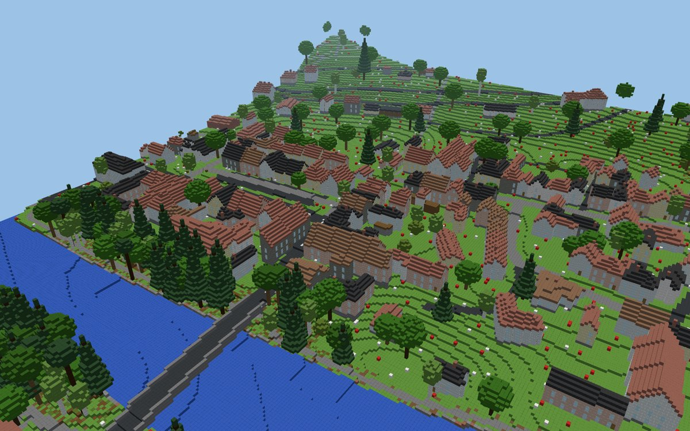
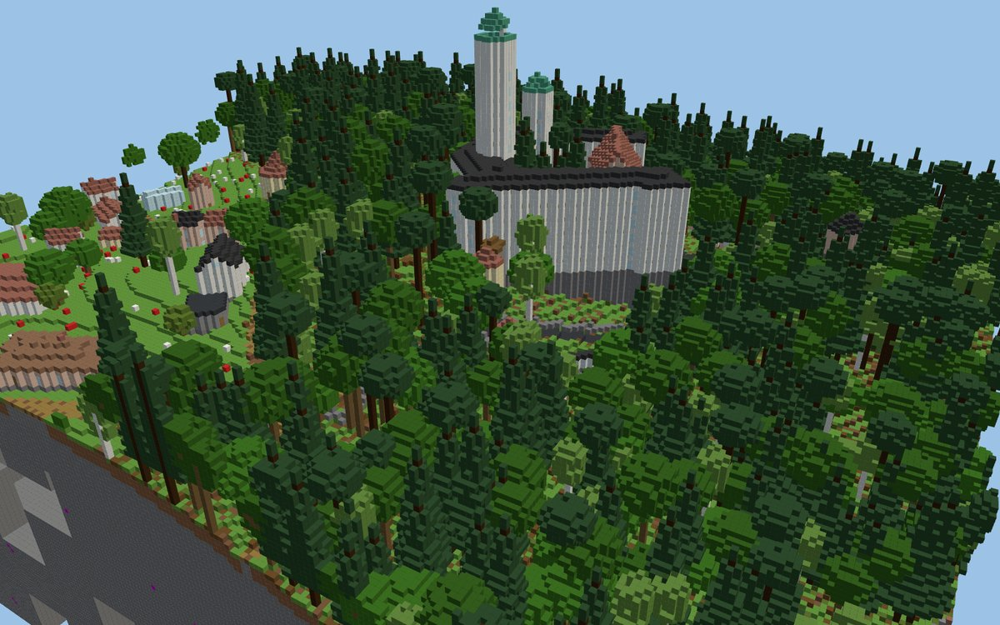
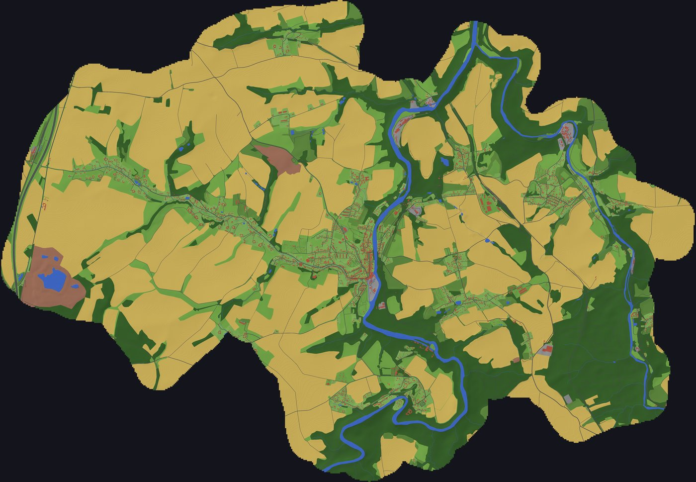

# SachsenCraft – Sachsen 1:1 als Minecraft-Welt

Dieser Generator baut aus echten Geodaten eine **Minecraft-Java-Welt im Maßstab 1:1** (1 Block = 1 Meter).
Die erste fertige Welt ist die Gemeinde **Lunzenau** (Mittelsachsen) mit allen Ortsteilen:
Lunzenau, Cossen, Göritzhain, Elsdorf, Himmelhartha, Rochsburg (mit Schloss) und Berthelsdorf.

Installation der fertigen Welt mit Mods und Shader: siehe [`modpack/ANLEITUNG.md`](modpack/ANLEITUNG.md).





*(Vorschau ohne Shader, aus den fertigen Weltdateien gerendert)*

## Was in der Welt steckt

| Was | Woher | Wie in Minecraft |
|---|---|---|
| Gelände | Copernicus-Höhenmodell GLO-30 (30-m-Raster) | Echte Höhen, **Y + 100 = Meter über NHN**. Waldkronen (≈10 m) und Dächer sind aus dem Oberflächenmodell herausgerechnet |
| Gebäude (6.600) | Overture Maps: OpenStreetMap-Grundrisse, Höhen u. a. von Microsoft | Echte Grundrisse und Höhen. Sattel-, Walm-, Zelt-, Pult-, Flach- und Kuppeldächer, Fenster je Etage, Haustür zur Straße, Etagenböden, Leitern, Schornsteine |
| Schloss Rochsburg | OpenStreetMap-Gebäudeteile | Bergfried (46 m) und Wendelstein mit Kupferhauben |
| Straßen und Wege | Overture Maps (OSM) | Breite und Belag (Asphalt mit Mittellinie, Pflaster, Schotter, Feldweg, Gehweg), ebene Querprofile, Brücken mit Geländer und Pfeilern |
| Gewässer | Overture Maps (OSM) | Zwickauer Mulde, Chemnitz, Bäche mit Gefälle, Teiche mit Seerosen, Schwimmbecken |
| Landnutzung | Overture Maps (OSM + Satellitenklassen) | Felder mit Weizen, Kartoffeln, Karotten, Rüben oder Brache, Wiesen mit Blumen, Wald, Gärten, Friedhöfe, Steinbrüche (roter Porphyr) |
| Bäume | aus den Waldflächen | Fichten, Kiefern, Buchen, Eichen, Linden, Birken und Obstbäume in echter Größe (bis 26 m) |
| Kleinobjekte | Overture Maps (OSM) | Straßenlaternen, Bänke, Zäune, Hecken, Mauern, Masten |
| Schilder | Straßennamen, Orte | Straßenschilder alle ~140 m, Schilder an Geschäften und Einrichtungen |
| Untergrund | erzeugt | Stein, Tiefenschiefer, Grundgestein, Erze |

> **Warum nicht Google Maps?** Die Nutzungsbedingungen von Google verbieten, Karten- oder 3D-Daten herauszulösen
> und weiterzuverwenden. Die genutzten offenen Daten (OpenStreetMap, Overture, Copernicus) sind dafür freigegeben.
> Noch genauer wären die amtlichen Daten des Landes Sachsen (GeoSN: DGM1 mit 1-m-Gelände und LoD2-Gebäude mit
> echten Dachformen). Sie sind ebenfalls kostenlos. DGM-GeoTIFFs nimmt der Generator schon jetzt an
> (Dateiname mit `dgm` in `dem/`).

## Selbst erzeugen (z. B. weitere Orte in Sachsen)

Voraussetzung: Python 3.11+.

```bash
pip install -r requirements.txt

# 1) Daten für ein Rechteck (Länge/Breite) laden
python -m sachsencraft.fetch --ziel daten/lunzenau --bbox 12.675 50.930 12.825 50.997

# 2) Welt erzeugen (nur die Gemeinde + 300 m Rand)
python -m sachsencraft.generate --data daten/lunzenau --out "Lunzenau 1zu1" \
    --gebiet Lunzenau --nur-gemeinde --rand 300

# 3) Modpack-Datei mit der Welt bauen
python modpack/build_mrpack.py --welt "Lunzenau 1zu1" --aus Lunzenau-1zu1.mrpack
```

Wichtige Optionen von `generate`:

- `--gebiet NAME`: Gemeinde aus den Verwaltungsgrenzen.
- `--nur-gemeinde`: Außerhalb der Grenze bleibt die Welt leer.
- `--y-offset 100`: Y = Höhe − 100. Für das Erzgebirge (bis 1215 m) reicht die normale Weltgröße
  nicht. Dafür muss später ein Datenpaket die Welthöhe erweitern.
- `--e0/--n0`: Ursprung (UTM 33N). Gleiche Werte bei mehreren Läufen ergeben zusammenpassende Gebiete.
- `--prozesse 8`: Anzahl paralleler Prozesse.

Geschwindigkeit: Lunzenau (≈150.000 Chunks) braucht auf 4 Kernen etwa 8 Minuten. Ganz Sachsen wären etwa
70 Millionen Chunks, also grob 300 GB und mehrere Tage Rechenzeit.

## Technik

- Ausgabe im Weltformat von **Minecraft Java 1.21.1** (DataVersion 3955). Neuere Versionen wie 26.3 stellen die
  Welt beim ersten Öffnen über „Upgrade and Play“ automatisch um.
- Alle Blockzustände wurden gegen das echte Minecraft-Blockregister (Minestom, Datenstand 1.21.11) geprüft, und
  der Chunk-Lader hat Stichproben fehlerfrei gelesen.
- Licht wird nicht gespeichert (`isLightOn = 0`). Minecraft berechnet es beim Laden selbst.
- Außerhalb der erzeugten Chunks: flache Leere (Superflat „the_void“), damit keine Fantasie-Landschaft angrenzt.

Module: `overture.py`/`fetch.py` (Daten), `terrain.py` (Gelände), `water.py`, `roads.py`, `landcover.py`,
`buildings.py`, `vegetation.py`, `details.py`, `chunkgen.py` (Chunks zusammensetzen), `anvil.py`/`nbt.py`/`level.py`
(Dateiformat), `preview.py`/`render3d.py` (Prüfung und Vorschau), `orte.py` (Teleport-Liste).

## Datenquellen und Lizenzen

- © OpenStreetMap-Mitwirkende (ODbL 1.0), über die Overture Maps Foundation
- Overture Maps Foundation (CDLA-Permissive 2.0 / ODbL je Thema), Gebäudehöhen u. a. Microsoft ML Buildings (ODbL)
- Copernicus DEM GLO-30: © DLR e.V. 2010–2014 und © Airbus Defence and Space GmbH 2014–2018, bereitgestellt
  unter COPERNICUS durch die Europäische Union und die ESA

Kein offizielles Minecraft-Produkt. Nicht von Mojang oder Microsoft genehmigt oder mit ihnen verbunden.
